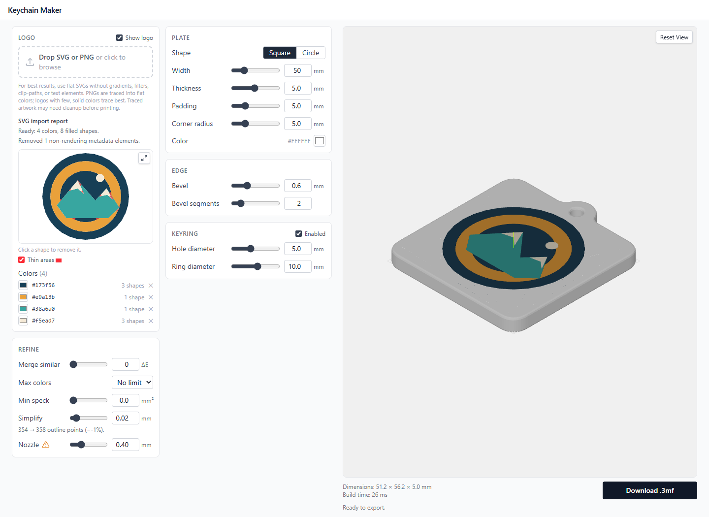
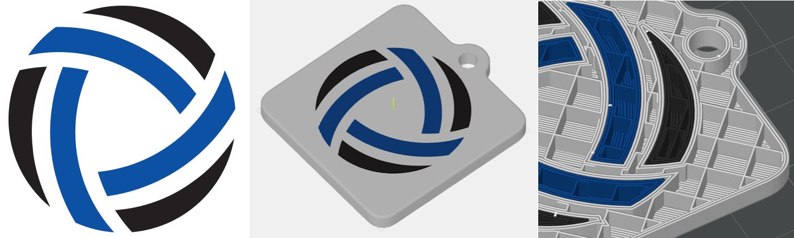

# Keychain Maker

Turn a flat SVG logo into a 3D-printable, multi-color keychain directly in the browser.

[Try the live app](https://andzhik.github.io/keychain-maker/)



## What it makes

Keychain Maker takes a clean, filled SVG, separates its shapes by color, builds a beveled base plate with an optional keyring hole, and exports a slicer-ready `.3mf` file.



## Highlights

- Upload an SVG logo and preview it immediately in 3D
- Or upload a PNG, JPEG or WebP: it's traced into flat colors in the browser (pick the maximum number of colors and whether to drop an opaque background, and tune how much outlines are smoothed, how readily corners are rounded off, and whether nearly level edges are straightened)
- Preserve logo colors as separate printable materials, with overlapping shapes resolved in paint order
- Refine the logo for printing: change, merge or remove colors, limit it to N filaments, drop specks below a size in mm², click shapes in the 2D preview to remove them, and see features too thin for your nozzle highlighted in red
- Simplify outlines to a tolerance in mm (0.02 mm by default) to cut the model's polygon count, and compare the result against the original in an enlarged, zoomable 2D preview that opens over the settings and 3D view, so the logo and refine controls stay usable
- Choose a square or circle base plate
- Tune base thickness, bevel, corner radius, padding, logo height, and target size
- Add or remove the keyring hole
- Inspect the model with an interactive Three.js viewport
- Export a multi-color `.3mf` for modern slicers
- See actionable import errors and export readiness; failed imports clear the previous artwork, and downloads wait for the current model to finish building
- Use the full controls and export flow on phone and tablet screens with a vertically scrolling layout
- Remember the last SVG, settings and refinements across reloads (browser localStorage)

## Best SVG Inputs

For the cleanest geometry, use simple SVG artwork made from filled paths.

- Convert text to paths before uploading
- Convert visible strokes to filled outlines; mixed fills and strokes are rejected to avoid losing artwork
- Avoid gradients, filters, clip paths, masks, and embedded images
- Prefer logos with clear color regions and moderate path complexity
- A traced PNG works best for flat logos with a few solid colors; photos and gradients come out posterized. With an opaque background, white details touching the background are removed with it

## Import Validation and Limits

The SVG parser returns a structured success/error result. Unsupported text,
images, gradient/pattern fills, stylesheets, clipping, masks, filters, and unsupported
linked copies produce visible instructions instead of silently losing artwork.
Inline fills/styles, transforms, holes, white fills, and bounded local `xlink:href`
copies of paths or groups remain supported. Unused paint definitions are ignored.

The SVG import report shows parsed color/shape counts and conservative cleanup:
non-rendering metadata, titles and descriptions are removed from the parsing
copy, and simple inline fills, fill rules and opacity are normalized to attributes.
CSS priorities and mixed duplicate declarations stay intact. Unsupported artwork
is rejected with repair instructions before cleanup. The uploaded SVG stays
unchanged in the saved session; cleanup never flattens or discards visible artwork.

The shared budgets in `src/utils/svgValidation.ts` apply to uploads, raster-generated
SVGs, and restored sessions:

| Budget | Limit |
| --- | --- |
| SVG file size | 2 MiB |
| Elements, including expanded local references | 4,096 |
| Nesting depth | 64 |
| Paths or primitive shapes | 512 |
| Filled shapes after conversion/paint-order resolution | 512 |
| Tessellated outline points, including holes | 20,000 |
| Numeric values in path, point, and transform attributes | 40,000 |

Markup limits run before SVGLoader. Tessellation and shape limits run before
polygon clipping; resolved geometry is checked again, and the builder independently
checks its input before outline unions, extrusion, or CSG. Degenerate/nonfinite
geometry and filled bounds of 0.0000001 SVG units or less are rejected. Simplify
the source artwork or trace a smaller image with fewer colors when a limit is reached.

The base-thickness and keyring-wall messages are advisory: the base recommendation
is the larger of 1.2 mm or three nozzle widths, and the keyring-wall recommendation
is 2 mm. These strength guidelines do not block export of valid geometry.

Tiny logo islands are also flagged when their filled area (minus holes) is less
than a disc two nozzle widths across. This complements the raster thin-feature
overlay, which can miss very small pieces. The check uses the final refined logo
at its fitted print size, follows size/nozzle/cleanup changes, and does not block
export. Increase Width, merge colors, or use Min speck to address the warning.

Configuration validation also runs independently of slider limits. Nonfinite,
negative, or impossible dimensions block model generation and export. Safe
padding, hole, bevel, and corner-radius adjustments keep the entered values in
the controls and show the effective values beside them; corner limits use the
actual fitted plate height. `validateConfig` returns structured field messages
and is also enforced for direct builder calls.

## Tech Stack

- Vue 3 with `<script setup>` and TypeScript
- Three.js for geometry, lighting, camera controls, and viewport rendering
- `three-bvh-csg` for logo cutouts in beveled bases
- `polygon-clipping` for resolving overlapping SVG shapes
- `three-3mf-exporter` for multi-color `.3mf` export
- Tailwind CSS v4
- Vite 6 and Bun

Model construction lives in `src/domain/keychainModel.ts`: it returns a detached
model and measured dimensions without Vue or a scene. `logoCutouts.ts` maps
outlines and counters to plate coordinates; shared layout remains in
`src/utils/logoFit.ts`. `src/three/sceneLifecycle.ts` owns attachment, visibility
and resource disposal. `useKeychainBuilder` connects these modules to Vue state.
The base, logo and CSG build order is unchanged.

## Local Development

```bash
bun install
bun run dev
```

Then open the local URL printed by Vite, usually `http://localhost:5173`.

## Scripts

| Command | Description |
| --- | --- |
| `bun run dev` | Start the Vite dev server |
| `bun run test` | Run focused unit tests for geometry and SVG parsing |
| `bun run test:browser` | Check import failures/races, export readiness/downloads, responsive layouts, and preview zoom in headless Chromium |
| `bun run build` | Type-check and build for production |
| `bun run preview` | Preview the production build |
| `bun run render [svg] [config]` | Capture headless render snapshots |
| `bun run measure [svg] [gpu\|swiftshader]` | Measure slider-change → rendered-frame latency |
| `bun run rasterize [svg format size bg]` | Regenerate PNG/JPEG/WebP tracer fixtures in `test-images/` |

## Render Snapshots

`bun run render` drives the real build pipeline in headless Chromium and writes PNG snapshots to `test-output/` for offline inspection. The default capture set includes isometric, back-isometric, top, front, and back views.

```bash
bunx playwright install chromium
bun run render
bun run render test-svg/c1.svg '{"edgeBevel":0}'
```

The render harness lives in `test-render/` and runs under Node because Playwright's browser pipe transport hangs under Bun.

## Raster Test Images

`test-images/` holds PNG, JPEG and WebP renders of the SVGs in `test-svg/` (same file names), for checking the image tracer against the original vector. The set covers transparent backgrounds, a solid white background, lossy JPEG/WebP noise, and sizes above and below the tracer's 512 px. `bun run rasterize` regenerates them; `bun run rasterize test-svg/logo.svg webp 512 none` renders a single file.

Not every SVG fixture is a supported vector import: `logo.svg` contains live text
and must report `TEXT_NOT_CONVERTED`; `broken logo.svg` has malformed XML and must
report `INVALID_SVG`. Browser rasterization can render text, so the raster versions
of `logo.svg` remain useful tracing fixtures. Use `c1.svg`, `coffee-badge.svg`,
`hills-badge.svg`, `name-tag.svg`, or `smile-heart.svg` for successful vector imports.

## Latency Probe

`bun run measure` drives the real app in headless Chromium, moves sliders, and reports per change: debounce wait, mesh build, wait for the next frame, GPU render, and total. It also prints the dev profiler's build-phase breakdown and simulates a 1 s slider drag.

```bash
bun run measure test-svg/c1.svg gpu          # real GPU via ANGLE/D3D11
bun run measure test-svg/c1.svg swiftshader  # CPU-emulated WebGL; render times are inflated
```

Historical baseline with a 150 ms debounce (c1.svg, RTX 3070, 1100×814 canvas):
~155 ms debounce + ~435 ms build + ~13 ms render ≈ **600 ms** per change.
The current debounce is **60 ms**; run the probe for current timings. Almost all
of the historical build time was CSG subtraction (see Gotchas).

## Design Decisions & Gotchas

Things that look wrong or slow but are deliberate. Read before "fixing" them.

- **Layout widths stay bounded at every breakpoint.** At 1024 px and up, the controls occupy a 660 px panel (a 300 px logo column and a narrower settings column), beside a 3D preview capped at 720 px. Below 1024 px, the preview sits beneath the controls and the page scrolls vertically. The controls stay in two columns from 720 px up and stack below that. The enlarged logo preview's desktop left inset follows the logo column so its controls remain usable.
- **Logo cutouts are cut with CSG, not `shape.holes`.** Putting the cutouts into the plate shape before extruding would be ~200× faster, but `ExtrudeGeometry` bevels every contour, including holes, so the logo cutouts would get beveled edges and the inlaid logo wouldn't sit flush. The plate is extruded with only the outer edge and keyring hole beveled, then the cutouts are subtracted with `three-bvh-csg` (`cutoutBasePlateHoles` in `src/utils/meshBuilder.ts`). This one step is ~95% of the rebuild time (~440 ms for c1.svg). Exception: when the bevel is ≤ 0.01 mm there is nothing to protect, so the cutouts go straight into `shape.holes` and CSG is skipped.
- **The keyring hole *is* beveled on purpose.** It's added to `shape.holes` before extruding so its inner edge gets the bevel. Only the logo cutouts go through CSG.
- **Refinements never edit the SVG.** They're stored as settings (`Refinements` in `src/types/keychain.ts`) and applied to the parsed color groups before the model is built (`src/utils/refine.ts`, wired up in `useLogoRefinement`). The parser doesn't know about them, and every edit can be undone. Recolors and hidden shapes refer to the current logo (shapes by `color:index`), so they reset on a new upload; the cleanup settings carry over.
- **Each refinement step returns a new array only when its output changes.** Because groups are compared by identity (below), `refineColors` and `removeSpecks` keep their last result per input and return it again when nothing changed (e.g. a merge tolerance below every color distance). Otherwise every slider tick would trigger a ~400 ms rebuild.
- **Speck sizes and thin features are measured at the printed size.** Both use the logo scale from `fitLogo` (`src/utils/logoFit.ts`), the same function the builder sizes the plate with, so they follow width, padding and plate shape. Specks use the scale before they're removed; removing them barely moves it.
- **Outlines are simplified as a shared-border graph, not ring by ring.** `simplifyGroups` (`src/utils/simplify.ts`) uses Ramer–Douglas–Peucker with the tolerance in mm at the printed size, not a minimum edge length, which would blunt sharp corners and miss long, gently curved runs (every curve is tessellated into 16 segments, however small). Neighboring colors share borders, and simplifying each ring on its own would open seams or overlaps between them. So points are merged across rings, vertices lying on another ring's edge (T-junctions polygon-clipping leaves where regions meet) are inserted into that edge, and every border between junctions is simplified once for all the rings along it. Pieces thinner than the tolerance collapse and are dropped, and their neighbors close over them. It runs last in the refinement chain, so it also shrinks the CSG cutouts and speeds up rebuilds.
- **Thin features are only flagged, not fixed, and the check is raster-based.** Thickening needs a polygon offset, which polygon-clipping can't do (Clipper2 could). `findThinFeatures` rasterizes the colors and the plate gaps and runs a morphological opening with exact distance transforms (~30 ms, debounced). Every acute corner fails by a sliver, so areas under a quarter of the minimum width squared are ignored; tips sharper than ~45° are still flagged, because they really do print blunt.
- **PNG tracing goes through SVG, and smooths borders, not regions.** `traceImage` (`src/utils/traceImage.ts`) quantizes colors, then treats the borders between colors as one graph on the pixel-corner grid, with junctions (three or more colors meeting) fixed. Each border is smoothed once for the colors on both sides, so neighbors stay sealed without the shared-border simplifier. Per border: Gaussian smoothing and Ramer–Douglas–Peucker take out the pixel staircase (plain RDP keeps its notches; smoothing alone leaves kinks along nearly straight runs), then Potrace's tests split the polygon into corners and curves. A point is a corner when it stands out from the line between its edges' middles by more than the *round corners* setting times the simplification tolerance (which grows with smoothing, so a coarser polygon doesn't turn curves into corners). Corners go back to where lines fitted to the unsmoothed pixels meet, because smoothing rounds them off. A corner that anti-aliasing cut into two close points between long edges is restored the same way, but only between long edges, or the steps of an O would become sharp. Every other point becomes a quadratic curve from edge middle to edge middle, and is first moved to where lines fitted to the smoothed border meet, or curves shrink inward. Anti-aliasing clusters are recognized by color *and* position: a color lying between two bigger ones is dropped only if most of its pixels sit on borders, otherwise a real color (gold between coral and white) is lost. One-pixel hairlines left along borders (blends that matched a real color) are cleared with the lone pixels. The background is the corners' color flood-filled from the border, not every pixel of that color, so white letters on a white page survive. The result is an ordinary SVG, so a traced logo is persisted, refined and exported like any upload.
- **The camera refits for a new SVG, not for refinements.** `ThreeViewer`'s `fitKey` is the parsed groups array, so hiding a shape or merging colors rebuilds the model without resetting your view.
- **Config changes are debounced, not throttled.** `ThreeViewer.vue` waits for 60 ms with no input before rebuilding. While inputs keep arriving within that window nothing rebuilds; the model updates after you pause. CSG builds are synchronous, so input complexity is bounded before building and export stays disabled while a rebuild is pending.
- **Import attempts invalidate old artwork.** A new upload clears the old parsed/persisted SVG immediately. Decode, read, trace, and validation failures leave no stale logo in the scene. Each async read/decode belongs to an upload generation, so a late result cannot overwrite a newer upload. Retracing preserves the mounted 2D preview and its zoom while pending, then invalidates artwork if it fails.
- **Export readiness follows the current build.** The viewer reports pending, ready, failed, or unavailable states. Its export group is unavailable while inputs are pending; WebGL/build/import failures disable Download. The default plain plate can still appear without uploaded artwork, but export requires a valid import.
- **Rendering is on demand.** `useThreeScene` only draws when `requestRender()` is called (or while orbit damping settles). Any code that changes the scene must call `requestRender()` or `fitCamera()`, or the change won't appear until the next mouse move.
- **`colorGroups` is compared by identity.** The viewer's watcher isn't deep, and the logo outline union is cached per array instance (in `logoOutline`). A new SVG or refinement must produce a new array; changing the old one in place won't trigger a rebuild or a new outline.
- **The logo's mirror and scale are baked into the geometry.** The SVG's Y flip is a negative scale. Putting it on a group transform would export to 3MF as a mirrored node, which slicers handle inconsistently, so it's applied to the vertices instead.
- **The model is built from clamped config, not the slider values.** `constrainConfig()` clamps combinations that break the geometry (e.g. a keyring hole bigger than its ring, or padding that would eat the whole logo). The UI keeps your raw values.
- **`ThreeViewer.vue` edits force a full page reload in dev.** It owns a WebGL context that can't be hot-swapped safely; swapping it in place would leak a context on every save.
- **The build profiler only runs in dev.** `src/utils/profiler.ts` logs a collapsed `[keychain build]` table to the console on every rebuild in `bun run dev`, and does nothing in production builds.
- **CSG acceleration trees are prepared explicitly.** `three-bvh-csg` 0.0.17 uses the deprecated `maxLeafTris` option with the installed `three-mesh-bvh`. `meshBuilder.ts` supplies the equivalent indexed, indirect trees using `maxLeafSize: 3` so ordinary builds do not emit deprecation warnings. Keep the triangle order and CSG build order unchanged.

## Deployment

In GitHub, set **Settings -> Pages -> Build and deployment -> Source** to **GitHub Actions**. The `gh-pages` branch stores the built site; an explicit Pages deployment makes it live.

- `.github/workflows/deploy.yml` runs on every push to `master`: it tests, builds, and publishes production to the branch root, keeping any existing previews.
- `.github/workflows/preview.yml` is manual (**Actions -> Deploy Branch Preview -> Run workflow**): it publishes the selected branch under `preview/<branch-slug>/`.
- `.github/workflows/publish-pages.yml` runs after either workflow succeeds: it uploads the entire `gh-pages` branch as a Pages artifact, deploys it, and verifies that production and every retained preview serve the uploaded HTML. It can also be run manually to redeploy the stored site.

All three workflows share one concurrency group so production, previews, and Pages deployments cannot race. The final deployment runs from `master`, including after a feature branch preview, so the `github-pages` environment can keep its deployment restriction to `master`.

Pushing to `gh-pages` with `GITHUB_TOKEN` does **not** trigger a Pages build. A successful build-and-push workflow alone does not mean the live site was updated; check **Publish GitHub Pages** for the deployment result.

After a production build, check the live HTML against `dist` with `node .github/scripts/verify-pages.mjs https://andzhik.github.io/keychain-maker/ dist`. The check retries while Pages propagates; set `VERIFY_PAGES_ATTEMPTS=1` for an immediate pass/fail result.

The Vite base path is controlled by `VITE_BASE_PATH`, so the same build can target local preview, production, or a branch preview path.
