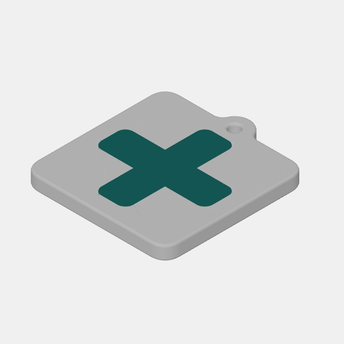
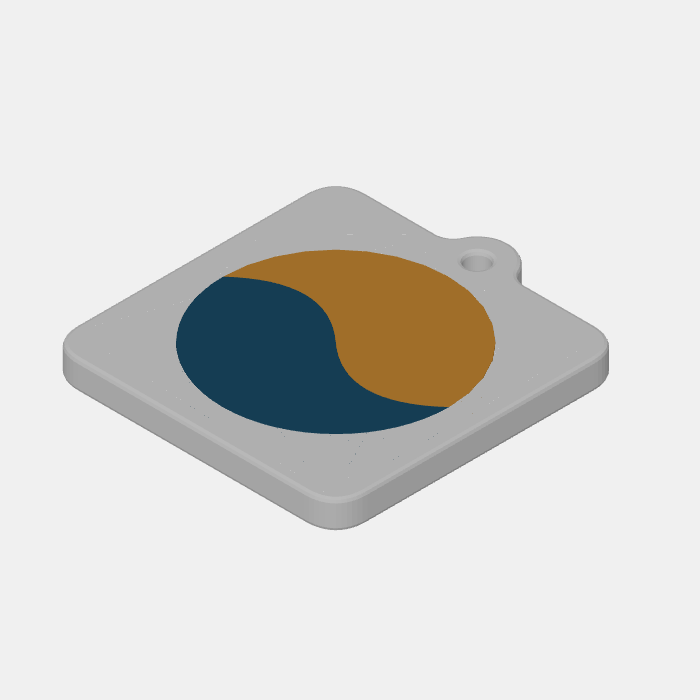
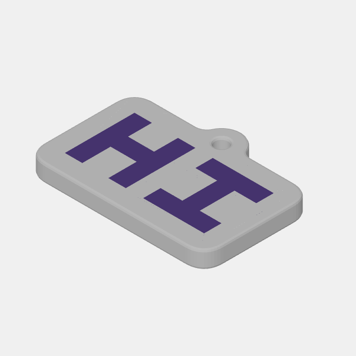
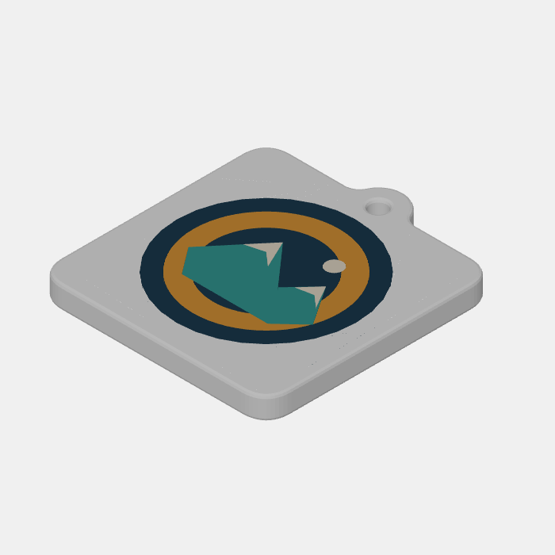

# Curated SVG examples

Download an SVG below, open [Keychain Maker](https://andzhik.github.io/keychain-maker/),
and upload it with the file picker. These small, original artworks are available
under [CC0](../examples/LICENSE), including for commercial use. The lettering is
drawn from geometry; no font or third-party logo is required.

| Example SVG | Logo colors | What to check |
| --- | --- | --- |
| [Rounded plus](../examples/simple-logo.svg) | 1 | Same-color overlapping primitives merge into one island. |
| [Two-color wave](../examples/two-color-logo.svg) | 2 | Paint order separates two colors along a shared curved border. |
| [Path lettering](../examples/text-converted-to-paths.svg) | 1 | Two readable letters import without live text or fonts. |
| [Orbital badge](../examples/complex-logo.svg) | 4 | Overlaps, a ring counter, and separate detail islands retain their colors. |

## Settings for a first pass

The screenshots below come from the repository's real model/render pipeline,
using these settings for **each** example:

| Control | Value |
| --- | --- |
| Plate shape / color | Square / white (`#ffffff`) |
| Width / border | 50 mm / 5 mm |
| Thickness / corner rounding | 5 mm / 5 mm |
| Edge chamfer / edge roundness | 0.6 mm / 2 |
| Keyring loop | On; 5 mm hole size, 10 mm loop size |
| Colors | Original colors |
| Nozzle size | 0.4 mm |
| Merge similar / max colors / remove small details | 0 / No limit / 0 mm |
| Simplify outlines | 0 mm for an exact render-harness comparison; the app's usual 0.02 mm is also suitable |

Plate and cleanup settings carry over between uploads; recolors and hidden
colors/shapes reset for a new upload. For screenshot comparisons, set the values
above (tick **Advanced options** to see them all), use **Reset edits** on the face,
then set Simplify outlines to 0. Reset keeps the current Nozzle size, so check that
it is 0.4 mm too. The width is the nominal plate width:
the measured dimensions also include the bevel and keyring. Preview lighting can
make the white base appear gray, and the 3D view is rotated relative to the SVG.

## Rounded plus

[Download simple-logo.svg](../examples/simple-logo.svg)



**Expected:** one teal color and one connected logo island. The two overlapping
rounded rectangles form one solid plus, with no internal seam.

**Recommended:** use the common settings above. This is the quickest first import
and export check; the broad arms should produce no thin-area or tiny-island advice
with a 0.4 mm nozzle at 50 mm width.

**Caveat:** the SVG has two source primitives but only one resolved island.
Import path counts and final shape counts therefore need not match. The white
base is a separate print material from the teal logo.

## Two-color wave

[Download two-color-logo.svg](../examples/two-color-logo.svg)



**Expected:** two colors and two resolved islands. A blue wave covers part of a
gold disc; gold remains only in the visible portion. The curved border should
meet without a gap or overlapping volumes.

**Recommended:** start with the common settings. Keep **Max colors: No limit**
to preserve both materials; try **Max colors: 1** afterward to see their shared
border disappear, then reset it before comparing the screenshot.

**Caveat:** thin-area advice can appear where the wave reaches the disc's edge.
Those pointed ends are intentional. Inspect the red 2D overlay and the slicer
preview, or increase Width to give the details more room. Advice does not block
a valid export.

## Path lettering

[Download text-converted-to-paths.svg](../examples/text-converted-to-paths.svg)



**Expected:** one purple color with two separate islands spelling **HI**. There
are no `<text>` elements: the original block lettering is supplied as filled
paths, which is the format a vector editor's Convert text to paths command
should produce.

**Recommended:** use the common settings and the **Square** plate option, which
fits a rectangle to the artwork's proportions. The broad letter stems should
produce no thin-area or tiny-island advice at the recommended size.

**Caveat:** this demonstrates the result of outlining letters; the app does not
convert arbitrary live text or find fonts. The fitted plate is shorter than the
other examples because the lettering is wide. A circle plate also works but
scales the lettering down to fit inside the circle.

## Orbital badge

[Download complex-logo.svg](../examples/complex-logo.svg)



**Expected:** four colors and eight resolved islands: a dark blue background,
gold ring, teal mountains, and cream details. The ring's counter exposes dark
blue, while later-painted mountains cover part of the ring. Cream peaks and a
small sun remain separate details. There should be no through-hole in the badge.

**Recommended:** start with the common settings, with **Remove small details: 0 mm** and
**Max colors: No limit** so all detail survives. For a larger print, try Width
60–70 mm, then inspect the thin-area overlay again.

**Caveat:** pointed mountain tips and narrow background gaps can trigger
thin-area advice. The circle, ring, and peaks share boundaries after paint-order
resolution; merging colors changes the number of islands. This is a more varied
manual regression fixture, rather than a worst-case performance benchmark.

## Manual regression checklist

1. Set the common settings, upload each SVG, and compare the 2D logo and 3D view
   with its description and screenshot. All four should import successfully.
2. Check the color counts above. Download should become enabled only after the
   current model is ready. Printability advice remains advisory.
3. Change Width, toggle the keyring, and switch between Square and Circle. Confirm
   the logo stays inside the plate and the dimensions update in millimeters.
4. Download a `.3mf` and open it in your slicer. Expect one base material plus
   the listed logo colors; inspect shared borders and the first/top layers.
5. Return to the common settings before comparing the next screenshot. Restore
   any hidden/recolored shapes and reset cleanup settings.

## Reproduce the screenshots

From the repository root, after `bun install` and `bunx playwright install chromium`:

```powershell
bun run render examples/simple-logo.svg
bun run render examples/two-color-logo.svg
bun run render examples/text-converted-to-paths.svg
bun run render examples/complex-logo.svg

Copy-Item test-output/simple-logo-iso.png docs/img/examples/simple-logo.png
Copy-Item test-output/two-color-logo-iso.png docs/img/examples/two-color-logo.png
Copy-Item test-output/text-converted-to-paths-iso.png docs/img/examples/text-converted-to-paths.png
Copy-Item test-output/complex-logo-iso.png docs/img/examples/complex-logo.png
```

Each invocation also produces top, front, back, and back-isometric views in
`test-output/` for closer inspection. The harness parses the SVG and builds the
real model with default configuration, without UI refinements. Keep `test-svg/`
and `test-images/` for their existing parser/tracer regression roles.
