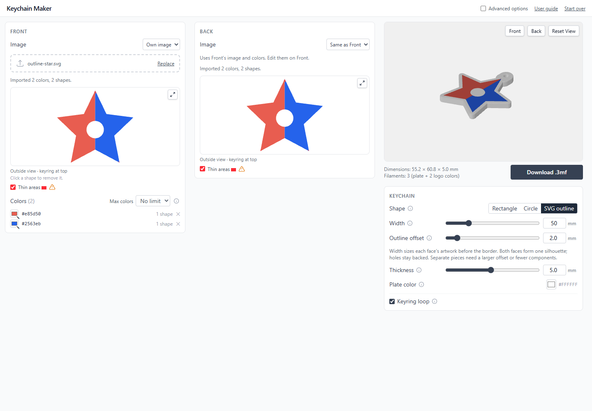
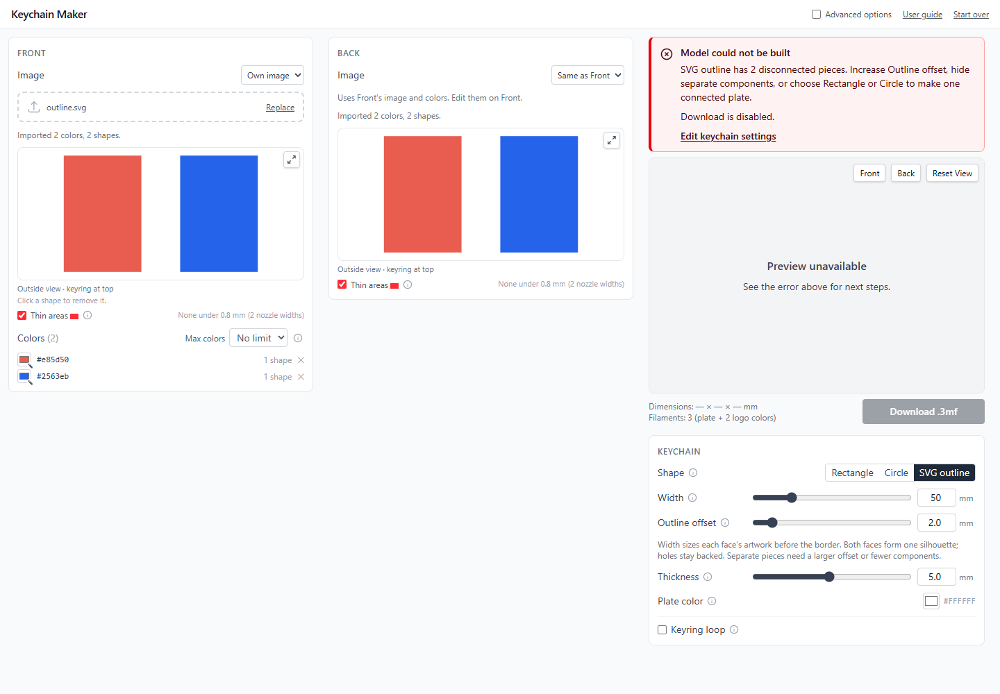

# SVG outline plates

[All documentation](README.md) · [Issue #15](https://github.com/andzhik/keychain-maker/issues/15)

Choose **SVG outline** in Keychain settings. **Outline offset** is always shown
and accepts 0–20 mm in 0.1 mm steps. Negative/invalid typed entries are constrained
by the number control; invalid restored/direct builder values block the model
with an explanation. The shape and offset are saved with other plate settings.

## Sizing

Each populated face is independently centered and scaled to **Artwork width**
(50 mm by default), preserving its aspect ratio. That is the artwork width
**before** the border. Border/padding and Corner rounding do not apply in this
mode; switching shapes preserves them.
Refinement tolerances and thin-feature checks use this same artwork scale.

The silhouette is the union of the visible, refined Front and Back artwork in
physical plate coordinates, including their independent outside-view mirrors.
Same as Front behaves like shared artwork; None contributes nothing. Hidden
colors/shapes and cleanup changes update the plate. Interior artwork holes are
filled for the silhouette, so they remain plate material, including holes formed
by the union of several paths. Internal color borders do not affect the perimeter.

The silhouette is expanded geometrically at print size using
[Clipper's polygon offset](https://github.com/junmer/clipper-lib/blob/master/Documentation.md),
with round joins and resolved intersections. It is not scaled, boxed or replaced
with a convex hull. Integer precision is 0.00001 mm; round-join chord error is at
most 0.01 mm. For example, Artwork width 50 mm and offset 2 mm give approximately
54 mm at the flat faces, before bevel/keyring. Zero follows the artwork. On a flat plate
the recess cutters then reach 0.001 mm past the plate edge, so no sub-micron wall
is left around the inlays; a chamfered plate instead gets a 0.0001 mm clearance,
since its face edge would otherwise lie exactly on the cutter walls.

## Connections and edges

If the requested offset leaves multiple components (including point-only
contacts), the model and Download are unavailable. Increase Outline offset until
pieces overlap, hide a component, or choose Rectangle/Circle. No component is
silently discarded, and the keyring does not connect separate pieces.

With **Keyring loop** enabled, **Keyring position** moves the loop around the
outline from **0–360°**, clockwise as seen from Front: **0°/360° top, 90° right,
180° bottom, 270° left**. The control is available in basic view. The plate,
artwork and face views stay upright while the attachment moves.

The hole follows the selected radial direction from the artwork's center,
moving smoothly as the angle changes. A rounded, reinforced neck of the loop's
diameter joins it to the outermost outline crossing on that line; it does not
snap sideways between outer tips. The hole stays 1 mm beyond the silhouette's
support line in that direction, clear of both faces' artwork. Any pockets
enclosed by the neck are filled, leaving only the intended keyring hole.
Loop/hole size constraints still apply. Edge chamfer is capped to keep the hole open.

The angle is saved with the plate settings, including while the keyring is off
or another plate shape is selected. Rectangle and Circle keep their top
attachment. Existing sessions default to 0° for a top attachment.
Invalid angles or an attachment that cannot form one connected plate with an
open hole block Download and show recovery guidance.

The flat faces retain the requested border. The chamfer bulges outward by up to
its configured size, matching existing plate sizing conventions. For arbitrary
concavities, nested rounded polygon offsets are triangulated into bevel bands;
this handles closing notches without folding per-vertex bevels. Sections closer
than 0.02 mm (twice the chord error) are merged so their rings never cross, and
each band is triangulated straight from them, keeping the mesh closed. A band is
subdivided only where a notch actually closes inside it. Thickness, inlay
depth and recesses use the existing Z intervals. Finished dimensions include the
bevel and keyring. Preview and 3MF export share the exact same meshes.

## Verification

`bun run test` checks concave offsets numerically, filled holes, unions,
disconnected pieces, invalid settings, persistence, face fitting, and volume/ray
partitions across zero/positive offsets, bevels and keyrings.

`bun run test:browser` includes `tests/browser/outline.test.ts`. It exercises the
real controls, refinements, reload, independent faces and mirrors, disconnected
recovery, and compares every exported triangle to the preview. Screenshots and
actual downloads are written under `test-output/issue-15/`.

After browser tests, `bun run test:slicer:outline` slices those downloads with
Bambu Studio CLI, using installed X1 Carbon / 0.4 mm / PLA / 0.2 mm profiles.
It verifies layer counts, printed filaments, solid middle layers, per-face color
layers and plate material in the star's circular counter. Logs, G-code and
toolpath SVGs are under `test-output/face-slicer/outline-*/`.
The harness adjusts the exporter's version/profile metadata for the installed
Bambu 1.9 CLI; it preserves mesh coordinates, topology and part assignments.

Issue [#38](https://github.com/andzhik/keychain-maker/issues/38) adds browser
checks for slider changes, 0°/360° equivalence, unchanged inlays, reload and
temporary shape/keyring changes. Additional downloads and a screenshot live
under `test-output/issue-38/`, including adjacent 271°/272°/273° smile-wordmark
positions. Unit tests sweep all 361 integer angles on flat, concave and
asymmetric silhouettes to catch jumps. Run `bun run test:slicer:keyring` after
the browser tests to slice these exports with Bambu Studio CLI. It checks that the hole
stays empty and the reinforced neck prints on every layer, with one connected
exterior perimeter and one hole perimeter in the middle layer. Logs, G-code
and toolpath SVGs are under `test-output/face-slicer/keyring-*/`.
This probe disables arc fitting so its distance checks measure linear extrusion
segments, and allows Bambu's normal seam gap when checking perimeter closure.

Validation including keyring positions: production build, 247 unit tests and
56 browser tests passed (browser files run sequentially to avoid concurrent
startup timeouts). All eight existing outline exports and seven keyring-position
exports passed Bambu Studio CLI checks at 25 layers each. The continuity fix
adds three smile-wordmark exports to that CLI check (ten keyring exports total).
Thin 0.8 mm plates with meeting inlays and backed counters are also covered by outline geometry
tests, with and without bevel.
The screenshots above are from the real desktop app, captured by these tests.
